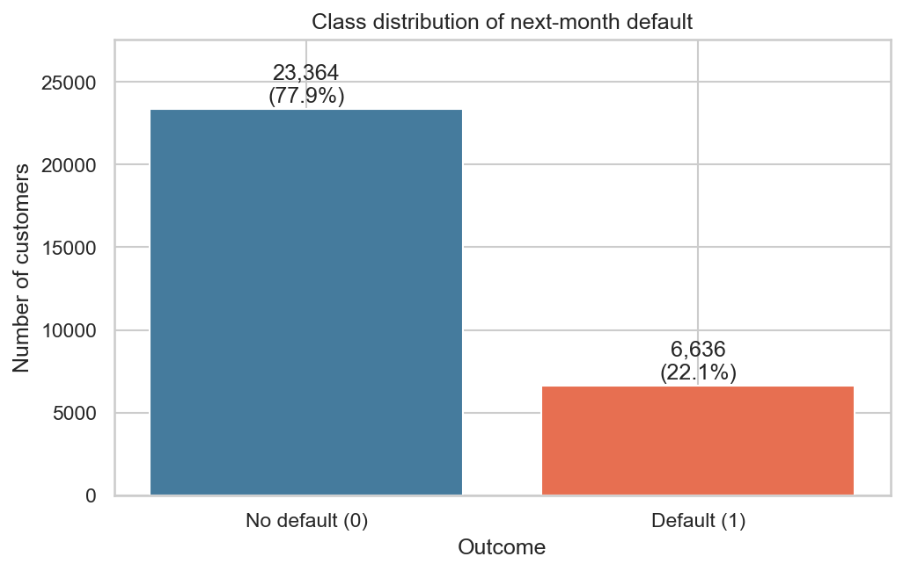
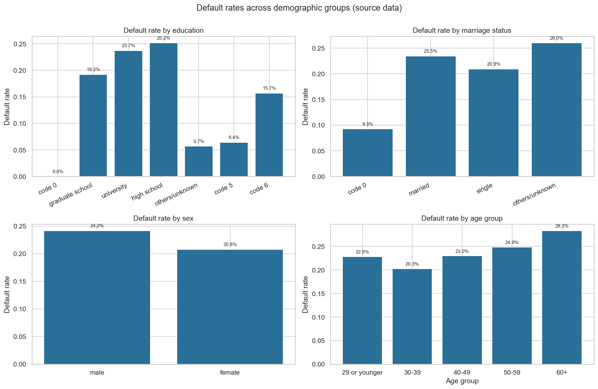
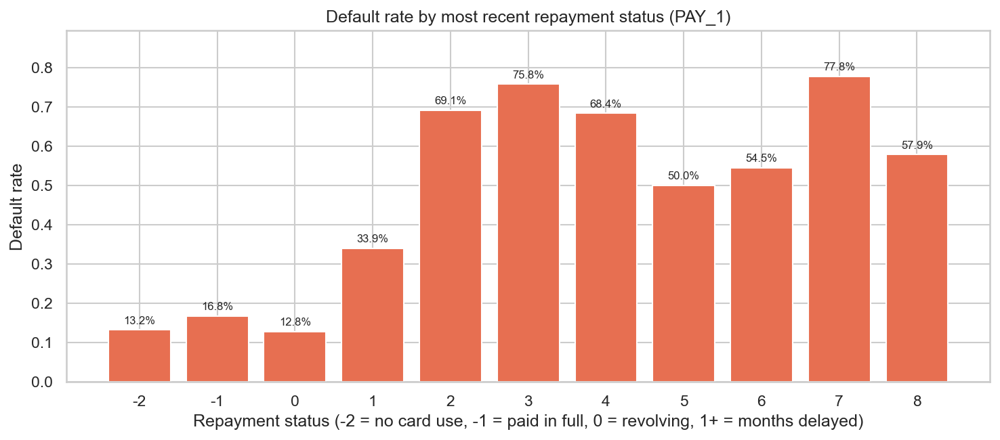
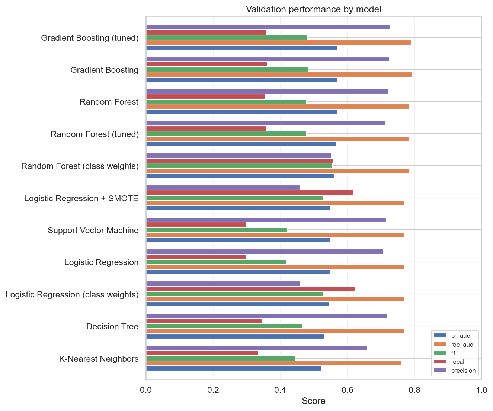
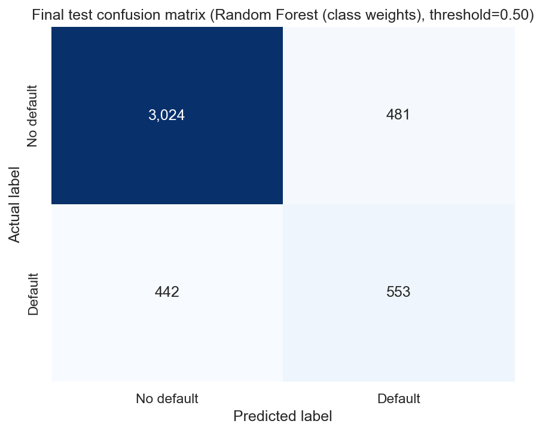
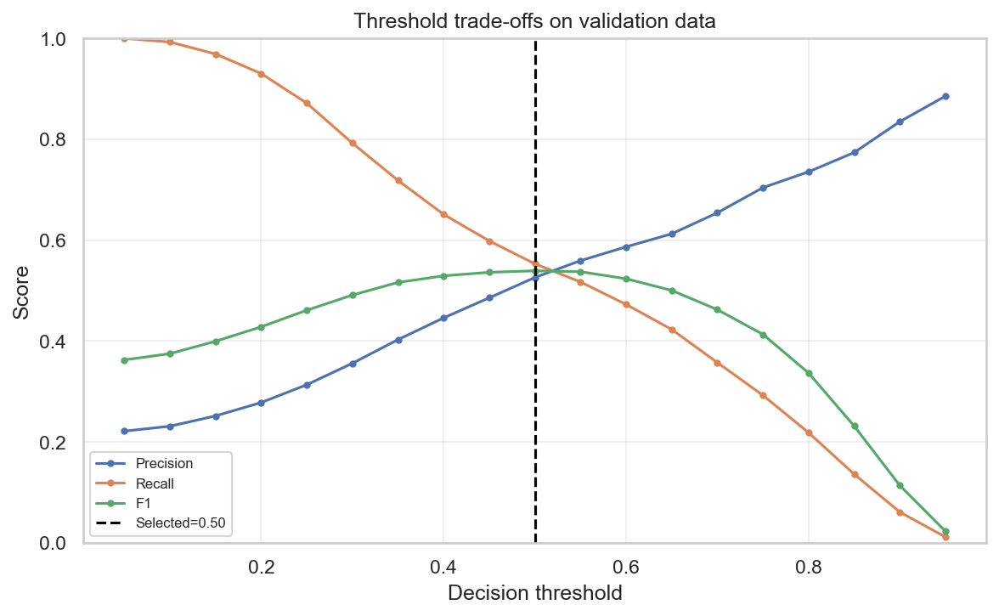
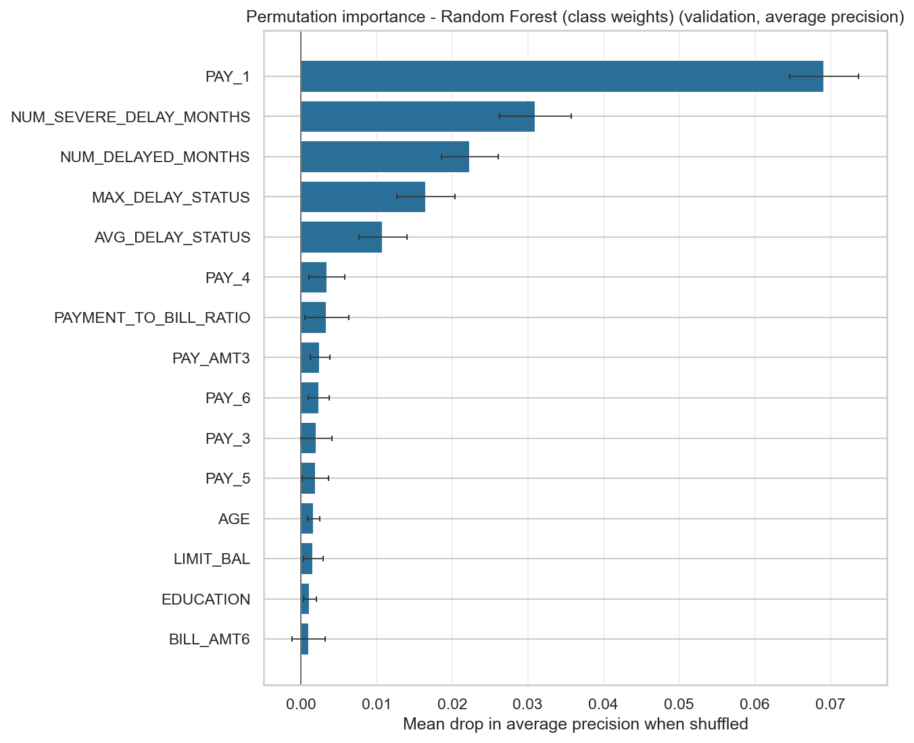
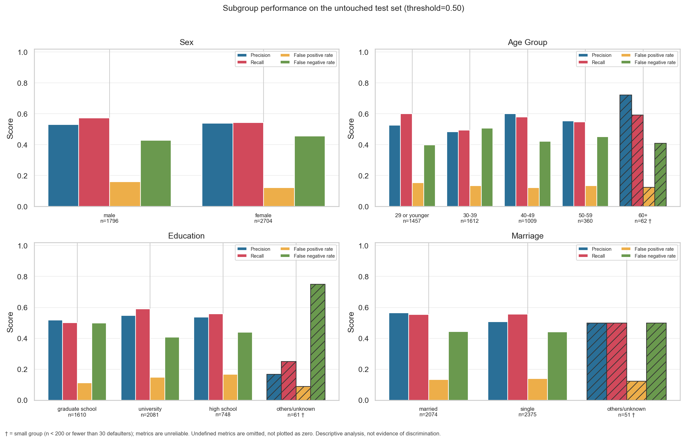

# Credit Card Default Prediction

An end-to-end, leakage-safe machine-learning project that predicts whether a credit-card customer will default on their next payment.

The repository contains reusable Python modules, a fully executed analysis notebook, unit and integration tests, trained model artefacts, evaluation reports, and figures generated from the real UCI dataset. All reported metrics come from executed code.

---

## Business Problem

A lender must decide whether to approve credit, adjust a limit, or prioritise collections outreach. A model that estimates next-month default risk supports those decisions.

The two classification errors have asymmetric costs:

* **False negative** — a customer who will default is predicted as safe. The lender may lose principal and incur collection costs.
* **False positive** — a customer who would have paid is flagged as risky. The lender may decline a good customer or impose unnecessary restrictions.

Because only **22.12%** of customers default, accuracy is misleading: a model that always predicts "no default" is 77.89% accurate but catches zero defaulters. This project therefore prioritises **recall, F1, ROC-AUC, and PR-AUC**, and analyses the decision threshold explicitly.

---

## Dataset

**Source:** [UCI Machine Learning Repository — Default of Credit Card Clients](https://archive.ics.uci.edu/dataset/350/default+of+credit+card+clients)

**Citation:** Yeh, I. C., & Lien, C. H. (2009). The comparisons of data mining techniques for the predictive accuracy of probability of default of credit card clients. *Expert Systems with Applications, 36*(2), 2473–2480.

**Description**

| Property | Value |
|---|---|
| Records | 30,000 customers |
| Raw columns | 25 (1 ID + 23 features + 1 target) |
| Target | `default` (renamed from `default payment next month`), 1 = default |
| Default rate | 22.12% (6,636 defaults, 23,364 non-defaults) |
| Missing values | 0 |
| Duplicate rows / IDs | 0 / 0 |
| Features | Credit limit, sex, education, marriage, age, six repayment statuses, six bill amounts, six payment amounts |
| File format | Excel (`.xls`) with a metadata row above the header |

The original file is stored **unmodified** in `data/raw/` and is excluded from version control. The loader detects the filename and header row automatically and renames `PAY_0 → PAY_1` so the six month-based status columns are consistent.

---

## Objectives

* Understand the data and its quality issues.
* Explore meaningful relationships and visualise them.
* Clean undocumented category codes without discarding customers.
* Engineer domain-driven features with safe division.
* Split data before any learned preprocessing to prevent leakage.
* Compare six classifiers under a consistent preprocessing and evaluation protocol.
* Investigate class imbalance with class weights and SMOTE.
* Tune the most promising models without touching the test set.
* Analyse decision thresholds and select one from out-of-fold predictions on the training split only, without touching the test set.
* Refit the final pipeline on train + validation and evaluate once on test.
* Persist the model and threshold, and provide a validated prediction module.
* Verify everything with tests and an executed notebook.

---

## Project Structure

```
.
├── data/
│   ├── raw/                      # original Excel file (git-ignored)
│   └── processed/                # intermediate/output data (git-ignored)
├── notebooks/
│   └── credit_card_default_analysis.ipynb
├── src/
│   ├── __init__.py
│   ├── data_loader.py            # discovery, header detection, download
│   ├── data_cleaning.py          # quality report, category mapping
│   ├── feature_engineering.py    # 12 engineered features, safe division
│   ├── preprocessing.py          # stratified split, ColumnTransformer, Pipeline
│   ├── selection.py              # guardrail model-selection policy, cost sensitivity
│   ├── train.py                  # comparison, imbalance, tuning, final evaluation
│   ├── evaluation.py             # metrics, OOF probabilities, threshold analysis, permutation importance, figures
│   ├── fairness.py               # exploratory subgroup metrics and plot
│   └── predict.py                # validated scoring module and CLI
├── models/
│   ├── final_model.joblib        # pipeline + threshold + feature metadata
│   └── model_metadata.json
├── images/                       # 13 generated figures
├── reports/
│   ├── model_comparison.csv
│   ├── selection_policy.json
│   ├── classification_report.csv
│   ├── final_test_metrics.json
│   ├── threshold_analysis.csv
│   ├── training_summary.json
│   ├── data_quality_summary.json
│   ├── hyperparameter_tuning.csv
│   ├── feature_importance.csv
│   ├── feature_importance_model_based.csv
│   ├── subgroup_performance.csv
│   └── fairness_analysis.json
├── tests/
│   ├── conftest.py
│   ├── test_data_loader.py
│   ├── test_data_cleaning.py
│   ├── test_feature_engineering.py
│   ├── test_preprocessing.py
│   ├── test_selection.py
│   ├── test_fairness.py
│   ├── test_training.py
│   └── test_evaluation.py
├── .gitignore
├── README.md
├── requirements.txt
└── LICENSE
```

---

## Installation

Python 3.10+ is recommended.

```bash
python -m venv .venv

# Windows
.venv\Scripts\activate
# macOS / Linux
source .venv/bin/activate

pip install -r requirements.txt
```

---

## Dataset Download

The loader accepts `.xls`, `.xlsx`, and `.csv` files and prefers the official filename.

**Manual (recommended):**

1. Open <https://archive.ics.uci.edu/dataset/350/default+of+credit+card+clients>.
2. Download `default of credit card clients.xls`.
3. Place it in `data/raw/` without editing it.

**Automatic attempt:**

```bash
python -c "from src.data_loader import download_dataset; download_dataset()"
```

If the UCI server blocks the request, the command raises clear manual instructions. The project never substitutes fabricated data.

---

## How to Run

### Notebook

```bash
python -m jupyter notebook notebooks/credit_card_default_analysis.ipynb
```

The notebook executes end to end after the dataset is present and regenerates the EDA figures. It trains the full pipeline (about 14 minutes on the test machine), so all reported outputs are reproducible.

### Train the full pipeline

```bash
python -m src.train
```

Useful options:

```bash
python -m src.train --cv-folds 5 --tuning-iterations 6
python -m src.train --no-tune --no-imbalance
python -m src.train --quick           # two models, 2-fold CV, no tuning
python -m src.train --models "Random Forest" "Gradient Boosting"
python -m src.train --threshold-cv-folds 5 --importance-repeats 10
```

The command writes the model, reports, and figures. Threshold selection uses out-of-fold predictions on the training split only; the validation split is used once for model selection, and permutation importance is computed on the validation split.

### Run tests

```bash
python -m pytest -q
```

**Verified result: 122 passed, 0 failed** (about 25 seconds).

### Score new customers

```bash
python -m src.predict --input path/to/customers.csv --output reports/predictions.csv
```

The input must contain the 23 original feature columns (with the official names, or with `PAY_0` and `default payment next month`); `ID` is optional and extra columns are ignored. The module validates the schema, applies the same cleaning and feature engineering as training, locates the positive class through the pipeline's `classes_`, and returns the default probability plus a class decision using the saved threshold.

Example output format:

| ID | Default Probability | Prediction |
|---|---:|---|
| 1 | 0.829308 | Default |
| 2 | 0.545516 | Default |
| 3 | 0.207557 | No Default |

These values are real model outputs for the first three customers in the raw dataset, using the saved 0.50 threshold.

---

## Methodology Highlights

* **Split before learning:** stratified 70/15/15 split (`21,000 / 4,500 / 4,500`) with `random_state=42`, performed before imputation, scaling, encoding, or sampling.
* **Pipeline encapsulation:** median imputation + `StandardScaler` for numeric features and most-frequent imputation + `OneHotEncoder(handle_unknown="ignore")` for `SEX`, `EDUCATION`, and `MARRIAGE`. Every learned parameter is fitted on training data only.
* **Feature engineering:** 12 features built exclusively from static attributes and the six historical months; the target is never used. Zero credit limits and zero bills return 0 rather than `inf`.
* **Cleaning:** undocumented `EDUCATION` codes 0/5/6 → 4 (*others/unknown*); `MARRIAGE` code 0 → 3 (*others/unknown*). 345 education records and 54 marriage records were remapped, and **no rows were discarded**. Extreme financial values were retained as legitimate observations.
* **Test isolation:** hyperparameter tuning used training-only CV; the validation split was used once for model selection; threshold selection used out-of-fold predictions generated by re-fitting the pipeline inside 5-fold cross-validation on the **training split only**; the test set was evaluated exactly once after the final refit on train + validation.

---

## EDA Highlights



* The target is imbalanced: **22.12% default vs 77.88% non-default** (about 3.5 : 1).
* **Repayment history is the strongest signal.** Customers with at least one month of delay in `PAY_1` default at **50.3%** on average, versus **13.8%** for customers who are current or have no card usage. A status of `PAY_1 = 2` corresponds to a **69.1%** observed default rate.
* **Education:** high school **25.2%**, university **23.7%**, graduate school **19.2%** in this sample.
* **Age:** 60+ **28.3%**, 50–59 **24.9%**, 21–29 **22.8%**, 30–39 **20.3%**.
* **Sex:** male **24.2%**, female **20.8%**.
* The strongest Spearman associations with default are `PAY_1` (0.292), `PAY_2` (0.217), `PAY_3` (0.195), and negatively `LIMIT_BAL` (−0.170) and `PAY_AMT1` (−0.161).





These are **associations, not causal effects**. Demographic variables also require legal and fairness review before production use.

---

## Model Comparison

All models use identical preprocessing and are evaluated on the same validation split at a 0.50 reference threshold. Cross-validation (5-fold) uses the training split only. Rows are ordered by the selection policy described below.

| Rank | Model | Role | Eligible | Accuracy | Precision | Recall | F1 | ROC-AUC | PR-AUC | CV PR-AUC |
|---:|---|---|:---:|---:|---:|---:|---:|---:|---:|---:|
| 1 | **Random Forest (class weights)** | imbalance | **yes** | **0.8024** | **0.5528** | **0.5578** | **0.5553** | **0.7845** | **0.5623** | — |
| 2 | Gradient Boosting (tuned) | tuned | no | 0.8284 | 0.7271 | 0.3588 | 0.4805 | 0.7918 | 0.5713 | 0.5532 |
| 3 | Gradient Boosting | base | no | 0.8284 | 0.7243 | 0.3618 | 0.4826 | 0.7920 | 0.5709 | 0.5556 |
| 4 | Random Forest | base | no | 0.8276 | 0.7239 | 0.3558 | 0.4771 | 0.7856 | 0.5703 | 0.5567 |
| 5 | Random Forest (tuned) | tuned | no | 0.8264 | 0.7131 | 0.3598 | 0.4783 | 0.7834 | 0.5665 | 0.5546 |
| 6 | Logistic Regression + SMOTE | imbalance | no | 0.7544 | 0.4590 | 0.6191 | 0.5272 | 0.7708 | 0.5498 | — |
| 7 | Support Vector Machine (calibrated LinearSVC) | base | no | 0.8187 | 0.7157 | 0.2985 | 0.4213 | 0.7695 | 0.5491 | 0.5249 |
| 8 | Logistic Regression | base | no | 0.8176 | 0.7081 | 0.2975 | 0.4190 | 0.7711 | 0.5487 | 0.5237 |
| 9 | Logistic Regression (class weights) | imbalance | no | 0.7558 | 0.4613 | 0.6231 | 0.5301 | 0.7713 | 0.5479 | — |
| 10 | Decision Tree | base | no | 0.8253 | 0.7182 | 0.3457 | 0.4668 | 0.7707 | 0.5331 | 0.5258 |
| 11 | K-Nearest Neighbors | base | no | 0.8147 | 0.6594 | 0.3347 | 0.4440 | 0.7609 | 0.5235 | 0.5178 |
| 12 | Dummy (majority class) | baseline | no | 0.7789 | 0.0000 | 0.0000 | 0.0000 | 0.5000 | 0.2211 | — |



**Imbalance experiments.** Rebalancing shifts the operating point rather than improving ranking quality:

* Random Forest class weights raise recall from **35.6% → 55.8%** and F1 from **47.7% → 55.5%**, while precision falls from **72.4% → 55.3%** and PR-AUC changes only from **57.0% → 56.2%**.
* Logistic Regression class weights raise recall from **29.8% → 62.3%** but precision falls from **70.8% → 46.1%**; F1 improves from 41.9% to 53.0%, while PR-AUC stays essentially flat.
* SMOTE (applied inside the training pipeline only) produces a similar trade-off for logistic regression.
* Hyperparameter tuning did not beat the untuned Gradient Boosting model on training-CV PR-AUC (55.32% vs 55.56%), so tuning is not assumed to help automatically.

**Selection rule.** The earlier arbitrary weighted score has been replaced by a transparent guardrail policy (`src/selection.py`, `reports/selection_policy.json`):

1. At the 0.50 **reference threshold** (used only for eligibility, not as the final decision threshold), require **validation recall ≥ 0.55** and **validation precision ≥ 0.50**.
2. Among eligible models, select the highest **validation PR-AUC**. Ties are broken by validation F1 and then validation ROC-AUC.
3. If no model meets both floors, select the highest PR-AUC and explicitly report that the policy was not satisfied.
4. The baseline model is never eligible.

The floors are **modelling assumptions**, chosen to express a preference for catching a substantial share of defaulters while keeping the false-alarm rate operationally bounded. This is **not** a claim that a missed defaulter always costs more than a false alarm: **no verified financial cost matrix was available**, so this is a modelling objective rather than a validated cost optimisation. Under this policy only **Random Forest (class weights)** is eligible: it is the only model that combines recall ≥ 0.55 with precision ≥ 0.50 at the reference threshold. Gradient Boosting has slightly higher PR-AUC (0.5709 vs 0.5623) but recall of only 36.2%; Logistic Regression (class weights) and SMOTE reach 62% recall but at ~46% precision.

**Cost sensitivity (hypothetical).** To make the assumptions visible, the table reports expected cost per 1,000 scored validation customers if one false negative costs `c` and one false positive costs 1. It is **not** a business result.

| Model (at 0.50) | Cost, FN:FP = 1:1 | Cost, FN:FP = 5:1 | Cost, FN:FP = 10:1 |
|---|---:|---:|---:|
| Random Forest (class weights) — selected | 197.6 | 588.7 | 1,077.6 |
| Gradient Boosting | 171.6 | 736.0 | 1,441.6 |
| Logistic Regression + SMOTE | 245.6 | 582.4 | 1,003.6 |
| Logistic Regression (class weights) | 244.2 | 577.6 | 994.2 |

If false negatives were known to cost 5–10× false positives, a logistic-regression model would have the lowest hypothetical cost despite lower PR-AUC. That is precisely why the cost matrix must come from the business before production: the policy here encodes a defensible risk objective, not an observed cost optimum.

---

## Final Model and Test Evaluation

The selected pipeline was refitted on the combined training + validation data (25,500 records). The test set (4,500 records, 995 defaults) was evaluated once.

**Selected model:** Random Forest with `class_weight="balanced_subsample"`  
**Decision threshold:** 0.50, chosen by maximum F1 on out-of-fold predictions from 5-fold cross-validation on the **training split only** (validation-only diagnostic threshold: 0.50)

| Metric | Test value at 0.50 |
|---|---:|
| Accuracy | 0.7949 |
| Precision (default) | 0.5348 |
| Recall (default) | 0.5558 |
| F1 (default) | 0.5451 |
| ROC-AUC | 0.7802 |
| PR-AUC | 0.5598 |

**Confusion matrix (threshold 0.50):**

| | Predicted no default | Predicted default |
|---|---:|---:|
| Actual no default | 3,024 (TN) | 481 (FP) |
| Actual default | 442 (FN) | 553 (TP) |



At the selected threshold the model catches **55.6% of actual defaulters** (553 of 995) while 442 are missed. Of customers flagged as defaulters, 53.5% actually default. The out-of-fold F1 curve also peaks at 0.50 (F1 0.5391 on 21,000 training records); 0.55 reaches 0.5373. The selected threshold was fixed before the test set was scored, and the final pipeline was refit on train + validation (25,500 records) before that single evaluation.

Test PR-AUC (0.5598) is close to the out-of-fold PR-AUC (0.5534) and validation PR-AUC (0.5623), so there is no evidence that model or threshold selection overfit the selection data. Performance is honest and moderate — the model is better than chance but not a production-ready credit engine.

---

## Threshold Selection

**Method.** Model selection and threshold calibration are deliberately separated:

* The **validation split** is used once to compare candidate models under the documented policy.
* Threshold calibration uses **out-of-fold (OOF) predictions from the training split only** (21,000 records).
* The pipeline is cloned inside `StratifiedKFold(n_splits=5, shuffle=True, random_state=42)`, so preprocessing, model, and any resampling are re-fitted in every fold.
* Each record is scored only by the fold model that did not train on it.
* The threshold maximising OOF F1 is selected and **fixed before test evaluation**. The selected pipeline is then refitted on train + validation (25,500 records) and the test set is scored exactly once.
* The validation-only F1-maximising threshold is reported as a diagnostic, not used for any decision.

The test set is never used in this process. A limitation of this design is that the model is chosen on validation while the threshold is calibrated on training-only out-of-fold probabilities; the calibrated threshold therefore assumes the selected model's probability ranking transfers to the train + validation refit. OOF is not automatically superior in every setting: the five fold-models are smaller than the final model and share overlapping training data. The F1 objective also remains a proxy for costs, and the search grid is 0.05 wide.

Representative OOF rows (21,000 training records, 4,646 positives):

| Threshold | Precision | Recall | F1 | FP | FN |
|---:|---:|---:|---:|---:|---:|
| 0.20 | 0.2780 | 0.9300 | 0.4280 | 11,223 | 325 |
| 0.30 | 0.3558 | 0.7921 | 0.4910 | 6,663 | 966 |
| 0.40 | 0.4458 | 0.6509 | 0.5291 | 3,760 | 1,622 |
| **0.50** | **0.5259** | **0.5529** | **0.5391** | **2,316** | **2,077** |
| 0.55 | 0.5593 | 0.5170 | 0.5373 | 1,893 | 2,244 |
| 0.60 | 0.5866 | 0.4724 | 0.5234 | 1,547 | 2,451 |
| 0.70 | 0.6541 | 0.3573 | 0.4621 | 878 | 2,986 |



A threshold of **0.50** maximises out-of-fold F1; the validation-only diagnostic F1 maximum was also 0.50. A collections-focused strategy might prefer 0.30 or 0.20 for much higher recall (at the cost of many false positives), while an approval-focused strategy might prefer 0.60–0.70. The right choice ultimately depends on the verified dollar cost of a missed defaulter versus a rejected good customer, which is not available in this dataset.

---

## Feature Importance

**Primary method: permutation importance on held-out validation data.** The selected pipeline is fitted on the training split only, then each feature is shuffled on the validation split and the drop in average precision (PR-AUC) is measured over 10 repeats. This measures how much the fitted model's ranking depends on each feature, using data the model did not train on.

| Feature | Mean PR-AUC drop | Std. dev. |
|---|---:|---:|
| `PAY_1` | 0.0692 | 0.0046 |
| `NUM_SEVERE_DELAY_MONTHS` | 0.0310 | 0.0047 |
| `NUM_DELAYED_MONTHS` | 0.0223 | 0.0037 |
| `MAX_DELAY_STATUS` | 0.0165 | 0.0038 |
| `AVG_DELAY_STATUS` | 0.0108 | 0.0032 |
| `PAY_4` | 0.0035 | 0.0024 |
| `PAYMENT_TO_BILL_RATIO` | 0.0034 | 0.0029 |
| `PAY_AMT3` | 0.0026 | 0.0013 |
| `PAY_6` | 0.0024 | 0.0014 |
| `PAY_3` | 0.0020 | 0.0020 |



`PAY_1` dominates, and the delay-count and delay-severity aggregates are the next most useful. Many other features — including most bill amounts and utilisation features — have near-zero or **negative** permutation importance, meaning shuffling them did not hurt validation PR-AUC. Negative values are expected noise when a feature is not used or is redundant; they are not evidence of harm.

**Limitations.** Permutation importance is a predictive-association measure, not a causal explanation. Correlated and derived features share credit: the delay aggregates overlap heavily with `PAY_1`–`PAY_6`, so their individual scores are unstable and should not be added together. Shuffling one correlated feature can leave model performance intact because the model substitutes another. The earlier impurity-based importances (`reports/feature_importance_model_based.csv`) are retained for comparison only; tree impurity importance is biased toward high-cardinality and continuous features and is computed on the final refit, not on held-out data. No SHAP analysis is included because a reliable, fully validated explanation pipeline was not part of this scope.

---

## Subgroup Performance (Exploratory)

This is an **exploratory subgroup assessment**, not a complete fairness audit. It uses the frozen final model and the frozen threshold (0.50) on the held-out test set; subgroup results did not influence model or threshold selection, and no group-specific thresholds or predictions were introduced. Records with a missing demographic value form an explicit **Missing** group instead of being silently dropped, and metrics with a zero denominator are reported as `NaN` with companion `*_defined` flags. Complete tables are in `reports/subgroup_performance.csv` and `reports/fairness_analysis.json`.

| Attribute | Group | n | Defaults | Default rate | Precision | Recall | FPR | FNR |
|---|---|---:|---:|---:|---:|---:|---:|---:|
| SEX | male | 1,796 | 430 | 23.9% | 0.530 | 0.572 | 0.160 | 0.428 |
| SEX | female | 2,704 | 565 | 20.9% | 0.539 | 0.543 | 0.123 | 0.457 |
| AGE | 29 or younger | 1,457 | 321 | 22.0% | 0.526 | 0.601 | 0.153 | 0.399 |
| AGE | 30–39 | 1,612 | 326 | 20.2% | 0.483 | 0.494 | 0.134 | 0.506 |
| AGE | 40–49 | 1,009 | 242 | 24.0% | 0.601 | 0.579 | 0.121 | 0.421 |
| AGE | 50–59 | 360 | 84 | 23.3% | 0.554 | 0.548 | 0.134 | 0.452 |
| AGE | 60+ † | 62 | 22 | 35.5% | 0.722 | 0.591 | 0.125 | 0.409 |
| EDUCATION | graduate school | 1,610 | 311 | 19.3% | 0.518 | 0.502 | 0.112 | 0.498 |
| EDUCATION | university | 2,081 | 487 | 23.4% | 0.548 | 0.591 | 0.149 | 0.409 |
| EDUCATION | high school | 748 | 193 | 25.8% | 0.537 | 0.560 | 0.168 | 0.440 |
| EDUCATION | others/unknown † | 61 | 4 | 6.6% | 0.167 | 0.250 | 0.088 | 0.750 |
| MARRIAGE | married | 2,074 | 497 | 24.0% | 0.566 | 0.555 | 0.134 | 0.445 |
| MARRIAGE | single | 2,375 | 488 | 20.5% | 0.507 | 0.557 | 0.140 | 0.443 |
| MARRIAGE | others/unknown † | 51 | 10 | 19.6% | 0.500 | 0.500 | 0.122 | 0.500 |

† Group flagged as small (fewer than 200 records or fewer than 30 defaults); its metrics are statistically unreliable and should not be interpreted.



**What the numbers show.** Sex and marriage subgroups have similar precision, recall, and error rates. Age 30–39 has the lowest recall (0.494) and highest FNR (0.506), while 40–49 has the highest precision (0.601); these are descriptive differences of several percentage points, not proof of unfair treatment. Education groups show similar precision but recall ranging from 0.502 (graduate school) to 0.591 (university); the "others/unknown" group is too small to interpret.

**What they do not show.** Similar metrics do not establish fairness, and different metrics do not establish discrimination. Group differences can reflect different base rates, feature distributions, sample sizes, and model fit. A real fairness review would need pre-specified fairness criteria, confidence intervals, error-cost analysis by group, and legal/regulatory review. The dataset contains only the demographic fields supplied by the original study, so it cannot support a complete audit.

---

## Key Findings

1. **Repayment status is the dominant risk signal.** One month of delay roughly quadruples the observed default rate; two months of delay corresponds to a 69% default rate.
2. **Accuracy is the wrong headline metric.** The majority-class baseline is 77.9% accurate yet has zero recall.
3. **Class weighting is a trade-off, not a free win.** It materially improves recall and F1 for the selected model while reducing precision.
4. **Tuning is not automatically beneficial.** Random search did not improve PR-AUC beyond the untuned Gradient Boosting baseline, so the simpler untuned model remains competitive.
5. **A transparent guardrail policy replaced the arbitrary weighted score.** Only Random Forest (class weights) satisfies both the recall and precision floors at the reference threshold; higher-PR-AUC models miss far more defaulters.
6. **The threshold is a business decision, not a statistical constant.** Out-of-fold F1 on the training split selects 0.50; moving to 0.30 would raise OOF recall from 55.3% to 79.2% while increasing false positives from 2,316 to 6,663.
7. **Permutation importance confirms repayment behaviour and exposes redundancy.** `PAY_1` and the delay aggregates dominate; many bill, utilisation, and payment features add little once those are present.
8. **Subgroup differences are descriptive, not a fairness verdict.** Sex and marriage metrics are similar; age 30–39 has the lowest recall. Small groups are flagged and cannot support conclusions.

---

## Limitations

* **Historical cohort:** the data is from a Taiwanese card issuer in 2005; behaviour, products, and the macro environment have changed.
* **Random rather than temporal validation:** an out-of-time test on a later cohort is needed before deployment.
* **Single random split:** results carry sampling uncertainty; confidence intervals and repeated cross-validation are not reported.
* **Out-of-fold thresholding is not free of uncertainty:** the five fold-models are trained on 16,800 records rather than the final 25,500 and share overlapping training data, and the threshold grid is 0.05 wide. The validation-only threshold is reported as a diagnostic, not a decision, and neither estimate is a business-optimal operating point.
* **Probability calibration:** reliability curves and calibration methods are not separately evaluated, so probabilities should not be read as exact default rates.
* **F1-based threshold:** equal weighting of precision and recall is not a business cost model. No verified false-negative/false-positive cost matrix was available; a cost-sensitive threshold or expected-loss optimisation is preferable in production.
* **Limited features:** income, employment, and external credit-bureau data are absent.
* **Fairness:** the subgroup analysis is exploratory and descriptive, not a complete fairness audit. Small groups are statistically unreliable, and the data cannot support legal or regulatory conclusions. Sex, age, education, and marriage remain in the model because they exist in the source data; production use requires legal and fairness review and possibly exclusion of protected attributes.
* **Feature importance:** permutation importance is a predictive-association measure, not a causal explanation. Correlated and derived features share credit and can produce unstable or negative scores. Impurity-based importances are retained only as a biased comparison.
* **Model family:** only classic classifiers were compared; no gradient-boosted libraries such as XGBoost/LightGBM, stacking, or neural networks were tested.

---

## Future Improvements

* Validate with an out-of-time cohort and monitor drift.
* Calibrate probabilities and evaluate reliability diagrams.
* Obtain a verified FN/FP cost matrix from the business and optimise expected loss instead of F1.
* Conduct a formal fairness audit with pre-specified criteria, confidence intervals, and legal review, and consider removing protected attributes.
* Add SHAP explanations only after calibration and validation, and report them as associations rather than causes.
* Add external credit-bureau and income features.
* Benchmark XGBoost/LightGBM and stacking.
* Add confidence intervals, repeated cross-validation, and statistical model comparisons.
* Package the pipeline as a REST API or batch scoring job with schema validation and monitoring.
* Add CI (GitHub Actions) to run tests and enforce reproducibility.

---

## Technologies

Python 3.10, pandas, NumPy, scikit-learn, imbalanced-learn, Matplotlib, Seaborn, joblib, openpyxl/xlrd, Jupyter, pytest.

---

## License

This project is released under the [MIT License](LICENSE). The dataset is distributed by the UCI Machine Learning Repository and remains subject to its terms; the raw file is not committed to this repository.
